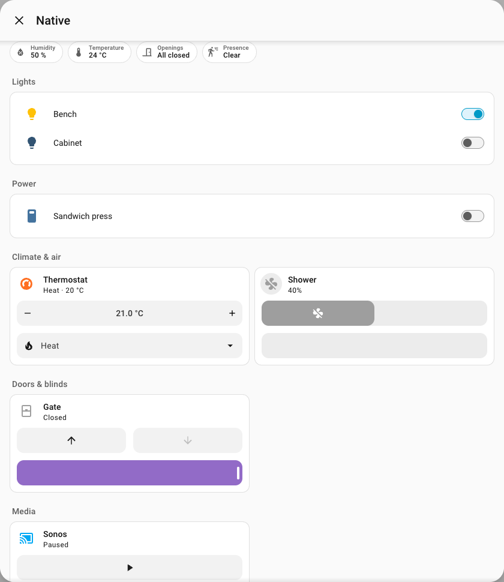

# Room controls

Room Overview and Room Control ship in one package. The integrated popup and the optional standalone card use the same room discovery and presentation rules.

## Native components

Home Assistant renders every control: lights and power use native entity rows; climate, fans, media players and covers use native tile features selected from the entity’s capabilities. Tapping an entity opens native More info for its full controls. Cameras use native picture-entity cards. Status uses native `ha-badge`, with individual readings in a native expansion panel. More room details and both editors use native expansion panels, selectors and forms. The room opens in native `ha-dialog`.

The package handles discovery, grouping, display names and responsive placement. It does not bundle copies of Home Assistant components, implement service dispatch, or replace their switches, sliders, dropdowns or camera rendering. Home Assistant supplies theme colors and control behavior.



## Shared room layout

`layout: compact` is the default. Controls are grouped into Lights, Power, Climate & air, Doors & blinds, Security, Media, Cleaning, Scenes & actions, and Controls. Empty groups disappear. Dotted technical names such as `your_room.light.bench` display as **Bench**. Device hierarchy remains visible where needed, and human-authored names remain intact. These display overrides do not rename entities or change automations.

Current temperature, humidity, presence, openings and other useful physical readings appear as badges. Event history is never interpreted as current presence. Healthy batteries, timestamps, camera object counters, unclassified readings and secondary configuration such as click mode stay under **More room details**. Low and unavailable batteries produce a visible warning badge.

**Always show** promotes a secondary entity to the main display and overrides automatic purpose filters. Explicit entity and device exclusions still win. Previously filtered configuration/firmware/automation entities remain omitted unless requested through Always show or the corresponding inclusion option. No entity is disabled or reconfigured.

```yaml
type: custom:room-overview-card
area: your_area_id
overview_exclusions:
  devices: []
  entities: []
control_exclusions:
  devices: []
  entities: []
control_options:
  layout: compact
  camera_layout: carousel
  everyday_controls: true
  always_show: []
```

`layout: tiles` uses native tiles throughout. The legacy `grouped` setting remains accepted and uses compact grouped rows. Feature grids use two columns where space permits and one below a 540 px card width. Native components manage their own text, focus and touch targets.

## Cameras

`camera_layout: carousel` mounts one native picture-entity card at a time, with native previous/next buttons. `camera_layout: tiles` displays the room’s cameras together. Camera cards request `camera_view: live`, so supported live streams start automatically when the room opens or the selected camera changes. Playback uses a 16:9 aspect ratio and a compact caption. Tapping opens native More info, and closing the room releases its camera components. Home Assistant owns streaming and the native camera viewer; the package does not store access tokens or sign camera URLs. Cameras without streaming support retain Home Assistant’s image fallback.

## Standalone card

```yaml
type: custom:room-control-card
area: your_area_id
layout: compact
camera_layout: carousel
exclude_devices: []
exclude_entities: []
always_show: []
```

The combined overview editor exposes the two exclusion lists separately. The standalone card has its own exclusion lists. An optional `entities` list replaces room discovery, while filters and manual exclusions continue to apply.

## Verification

Run `npm run check` and `npm run test:browser`. Browser checks use the real components from Home Assistant’s official public demo with simulated device states and API contexts. They never operate a real device. Native component contracts were checked with Home Assistant 2026.10 frontend APIs.

See Home Assistant’s [tile card](https://www.home-assistant.io/dashboards/tile/), [entities card](https://www.home-assistant.io/dashboards/entities/), and [picture-entity card](https://www.home-assistant.io/dashboards/picture-entity/) documentation.
